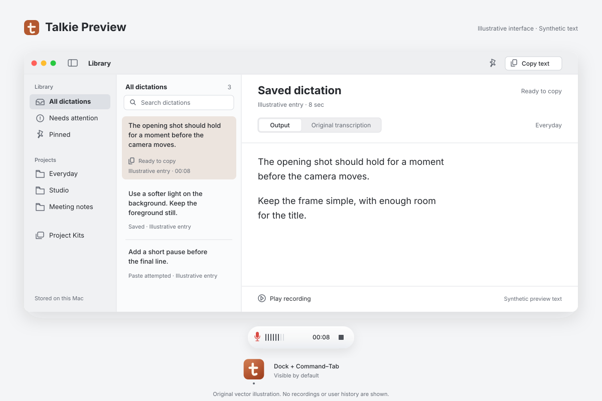

# Talkie

A native macOS dictation beta with on-device speech recognition, guarded text insertion and recoverable local history.

**Experimental portfolio project.** This is source for a locally built preview, not a notarised end-user release. Longer USB microphone captures and compatibility across custom editors remain under investigation. See [current status](docs/STATUS.md).



*Original vector illustration using synthetic text. This is an interface preview, not a screenshot or evidence of a completed recording.*

## The idea

Hold a shortcut, wait for the cue, and speak into the field where you are working. Talkie records locally, checks the captured signal, recognises speech on the Mac and saves the transcript before attempting insertion. When insertion is unavailable, the words remain available to copy.

- **Native and easy to find:** menu-bar controls, an original app icon in the Dock and Command–Tab by default, and a setting for menu-bar-only operation.
- **Compact recording overlay:** a native translucent capsule with input level, elapsed time, Stop and clear processing or delivery receipts. Reduced-transparency and contrast settings receive a solid surface.
- **Your shortcut and cue:** record a key combination or supported modifier-only shortcut; choose hold or toggle activation and an optional ready cue. Use the bundled chime or choose a short local audio file, preview it and adjust its volume.
- **Local recognition:** WhisperKit runs speech recognition on the device after model setup.
- **Recovery first:** journalled recordings, original and prepared transcripts, playback, retry and explicit delivery states in SQLite history.
- **Guarded paste:** check the destination, make one paste attempt and distinguish confirmed insertion from an unverified attempt. Never press Return or Send.
- **Project Kits:** preferred vocabulary, explicit corrections and prompt frames applied deliberately around your words.

See the [architecture](docs/ARCHITECTURE.md) for the capture, storage and delivery flow and the [interface design](docs/DESIGN.md) for the native surfaces and states.

## Build a local preview

The runtime target is macOS 14 or later, with Apple Silicon as the intended configuration. Building requires a compatible Swift 6 toolchain and a macOS 26 or later SDK for the native glass API; earlier supported systems use a material fallback at runtime. Swift Package Manager fetches the pinned dependencies. See [testing requirements](docs/TESTING.md).

```sh
./scripts/build-app.sh
./scripts/install-app.sh
```

The build produces `dist/Talkie Preview.app` with an ad hoc local signature. The installer writes to `~/Applications/Talkie Preview.app` without launching it. Open the preview when ready. In Settings, download the speech model, grant Microphone and Accessibility access, then test with a disposable text field. Recognition works offline after setup; model and tokenizer downloads require a network connection. Run one dictation app at a time, or choose distinct shortcuts to avoid conflicts.

To install and launch deliberately in one step, use `TALKIE_LAUNCH_AFTER_INSTALL=1 ./scripts/install-app.sh`. This opens only the separate preview application.

The Dock icon is shown by default. **Settings → General → Show Talkie in Dock** also controls Command–Tab visibility. Closing the Library or Settings keeps Talkie running; clicking its Dock icon opens the Library.

The preview uses a separate identity and local data location:

- Bundle identifier: `local.talkie.preview`
- Data: `~/Library/Application Support/Talkie Preview/`
- Build cache: `~/Library/Caches/talkie-preview-build/`

## Reliability and privacy

Saving and insertion are separate steps. A paste request does not establish that an editor accepted the text. Invalid or inaudible input is rejected before recognition. Exact repeated PCM produces a quality warning while recording continues, so later audio can still be saved. Local recognition can save a draft from an audible suspect take, but its warning persists and automatic insertion is blocked. Review the audio and draft in the Library; Retry can attempt recovery again. These checks cannot reconstruct speech that an input stream never delivered. Broader application, long-capture and hardware testing is still needed.

Quiet input or no recognised speech produces a brief overlay notice, keeps the recording in the Library and returns to idle for the next dictation. Storage, model and other unexpected failures still require attention.

Microphone audio and transcripts are processed locally; there is no account or hosted inference backend. Retention and local data protection are documented in [privacy and storage](docs/PRIVACY.md).

Standalone checks exercise the production history, signal, capture and shortcut code. They complement real microphone and editor tests; they do not replace them. See [testing instructions](docs/TESTING.md) and [snapshot verification](docs/VERIFICATION.md) for commands, evidence and limitations.

## Components and rights

Built with SwiftUI, AppKit, Core Audio, SQLite and WhisperKit. Speech models and tokenizer assets are downloaded separately and stay outside the repository.

Third-party components retain their own licenses and notices; see [third-party notices](THIRD_PARTY_NOTICES.md). A project-wide license for the original source and artwork has not yet been selected.
