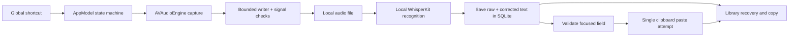

# Architecture

Talkie is a Swift executable using SwiftUI views hosted in AppKit windows and a menu-bar popover. It has no web server or hosted backend.

| Component | Responsibility |
| --- | --- |
| `TalkieMain.swift` | App lifecycle, Dock/menu-bar visibility, window reopening, shortcut registration and developer CLI |
| `AppModel.swift` | Capture and recognition orchestration, explicit UI state, permissions and recovery |
| `GlobalHotkey.swift`, `ShortcutRecorder.swift` | Custom combinations, modifier shortcuts, hold/toggle behavior and shortcut validation |
| `RecordingHUDSurface.swift` | A compact, nonactivating recording/receipt surface rendered from scalar presentation state, with native glass and accessible fallbacks |
| `AudioCapture.swift` | Native input selection, capture and file finalisation on a serial writer queue |
| `AudioSignalCheck.swift`, `RepeatedAudioCheck.swift` | Reject silence/invalid signal and detect a specific exact repeated-PCM failure mode |
| `SpeechEngine.swift` | Verified model setup, pinned local tokenizer and on-device recognition |
| `HistoryStore.swift` | SQLite session journal, raw/corrected/framed versions, kit snapshots, retention and recovery |
| `TextInsertion.swift` | Snapshot target field/caret/text, revalidate focus, emit Command–V once and check delivery |
| `ProjectKit.swift` | Explicit phrase corrections with protected code/URLs, and literal opt-in framing |
| `TalkieEnvironment.swift` | Separate preview storage and preferences identity |

## Recovery before convenience

A session is journalled before capture. Audio is written to its managed file while recording. Recognition saves raw text and its corrected variant before attempting insertion. If focus changes or delivery cannot be confirmed, the saved take remains available. Frames are applied deliberately in the Library and preserve the raw transcript. No automatic Return/Send action is part of the pipeline.

The repeated-audio check targets exact repeating complex PCM rather than repeated words. A detected problem raises a quality warning while recording continues, allowing later input to recover. On Stop, the warning is journalled before recognition. Audible suspect input may produce a saved draft for review, while automatic insertion remains blocked. The user can deliberately Retry it in the Library; the original capture warning remains attached to the take after recovery, formatting and delivery-status changes.

The check evaluates an exact matched span across quiet gaps and ignores an entirely inaudible floor. It is a narrow integrity guard, not proof that an input stream is complete or a replacement for listening to a longer test recording. Real device disconnection, engine reconfiguration and file-write errors still interrupt capture explicitly.

## Isolation

The portfolio preview uses `local.talkie.preview` and `Talkie Preview` storage. There is no data migration from another installation. Models are downloaded separately; the source repository contains neither weights nor user recordings.

See [PRIVACY.md](PRIVACY.md) for the complete storage and network boundaries and [STATUS.md](STATUS.md) for current limitations.
